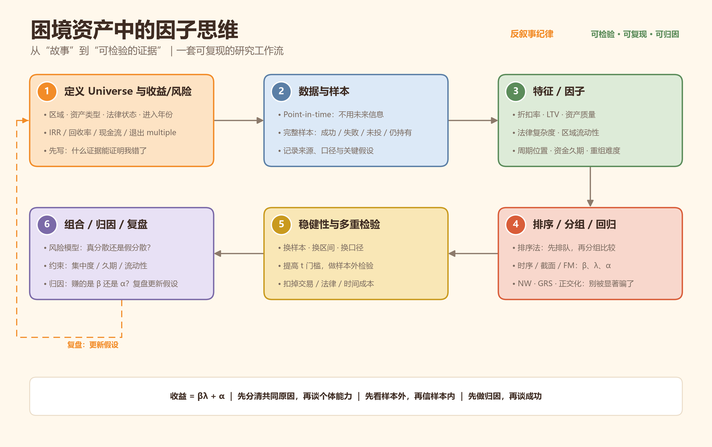

# 困境资产中的因子思维

> 从“故事”到“可检验的证据”：把第 2、6、7 章的方法论，用到困境资产投资里。



## 一、困境资产最大的风险，是“故事”而不是价格

做困境资产的人，几乎每天都在听故事：

- “这个资产是核心地段，只是股东流动性出了问题。”
- “这家公司基本面没问题，只是被抽贷了。”
- “这个价格已经是三折，闭着眼买都不会亏。”
- “上一轮周期我就是这么做的，赚了很多。”

这些故事不一定错，但它们有一个共同问题：**它们都是“叙事”，不是“证据”**。

困境资产的特殊性在于：

1. **样本少**：一个机构一年可能只看几十个项目，真正成交个位数；
2. **周期长**：一个项目从进入到退出 3~7 年，反馈极慢；
3. **异质性强**：每个项目的法律结构、资产、区域、债务人都不一样；
4. **幸存者偏差**：你听到的“成功案例”，往往是因为失败者不再发声；
5. **叙事驱动**：价格越便宜，故事越动人，越容易忽略风险。

所以，困境资产投资最需要的，不是更多的故事，而是一套**把故事拆成可检验问题**的方法。

这正是因子投资方法论的价值：它不教你“买什么”，它教你“怎么判断一个说法靠不靠谱”。

## 二、一个公式：把收益拆成 βλ 和 α

因子投资的世界观，可以压缩成一个公式：

```
E[R_i] = β_i' λ + α_i
```

- **β**：资产对某个共同风险的暴露；
- **λ**：市场为承担这个风险支付的价格；
- **α**：模型解释不了的、资产特有的超额收益。

把这个公式翻译到困境资产：

| 因子投资 | 困境资产 |
|---|---|
| 市场/行业/风格因子 | 宏观利率、信用利差、地产周期、区域流动性、行业景气、法律/监管环境 |
| β（暴露） | 你的资产/项目对这些共同风险的敏感度 |
| λ（溢价） | 市场为承担这些风险要求的折价/回报 |
| α（定价误差） | 你的项目选择、重组能力、法律执行、运营改善、退出时机带来的超额收益 |

**这个拆解最重要的一点，是防止把 β 当 α。**

很多困境资产的高收益，并不是“眼光好”，而是：

- 买在了信用利差高位（β）；
- 买在了地产周期底部（β）；
- 买在了流动性宽松、资产价格普涨的阶段（β）；
- 用高杠杆放大了 beta（β）。

真正难的是：**扣掉这些共同驱动之后，你的 α 还在不在？**

## 三、第2章的方法：把“感觉”变成“证据”

第 2 章讲的是排序法、三种回归、Newey-West、GRS、正交化。它们不是量化专利，而是困境资产研究的“语法”。

### 1. 排序法：先分组，再比较

排序法的核心：

```
价差组合收益 = R_high − R_low
```

做法：按一个变量把资产排队，分成 5~10 组，比较高组和低组的未来收益。

在困境资产里，你可以按这些变量排序：

- 折扣率（价格 / 内在价值或 NAV）；
- LTV / 抵押率；
- 资产质量（租金覆盖率、现金流稳定性）；
- 法律复杂度（是否有优先权争议、查封、多重抵押）；
- 流动性（区域市场深度、资产可分割性）；
- 债务人配合度 / 重组难度；
- 资金久期匹配度。

**关键不是“排序”本身，而是“分组之后还看不看得见差异”。**  
如果高折扣组和低折扣组的回收率没有系统差异，那“便宜”可能只是一个故事。

> 注意：排序法只假设“变量高低 ≈ 暴露高低”，不假设因果。分组差异也可能是行业、区域、规模混入——所以要做双重排序/控制变量。

### 2. 三种回归：β、λ、α

**① 时序回归：查每个项目的“敏感度”**

```
r_it = α_i + β_i' f_t + ε_it
```

- 把每个项目/资产的收益，对宏观、行业、区域等共同因子做回归；
- β = 对共同风险的敏感度；
- α = 扣掉共同风险后的超额收益。

困境资产里，“收益”可以定义为：

- 年度 IRR / 回收率；
- 现金流分配；
- 退出时的 multiples；
- 或者按季度 mark-to-market 的估值变化。

**② 截面回归：查“市场为哪类风险付钱”**

```
mean(R_i) = λ' β_i + α_i
```

- 在同一时点/同一批项目里，比较不同风险暴露对应的平均收益；
- λ = 市场为某类风险支付的价格；
- α = 个别项目的定价误差。

比如：在同一区域、同一资产类型里，法律复杂度高的项目，市场要求的折价（λ）是多少？你的项目是高于还是低于这个价格？

**③ Fama-MacBeth：每一期单独回归，再平均**

```
每期：R_it = λ_t' β_i + α_it
然后：λ = mean(λ_t)
```

为什么重要？困境资产的收益高度依赖“进入年份/周期位置”。把 2015 年、2018 年、2021 年的项目揉在一起回归，会掩盖周期差异。FM 的做法是：

- 每一期/每一批项目单独回归；
- 再对 λ_t 求平均；
- 用 Newey-West 修正标准误。

这更接近困境资产的真实工作方式：**一批一批看，再看长期平均。**

### 3. NW 与 GRS：别让标准误和联合检验骗你

**Newey-West**：困境资产的现金流/收益往往有自相关（一个项目影响下一年）、异方差（大项目波动大），普通 OLS 标准误会低估或高估。NW 修正后，t 值才更可信。

**GRS**：如果你有一组项目/策略，不要逐个看 α 是否显著；GRS 联合检验“所有 α 是否一起为零”。它回答的是：

> “这个策略/模型，整体上有没有留下解释不了的收益？”

但 GRS 只回答“联合是否为零”，不指出哪个项目有问题——所以还要逐个 α 检验定位。

### 4. 正交化：找到真正的增量

困境资产里，很多变量是高度相关的：

- “便宜”可能同时意味着“资产质量差”；
- “高折扣”可能同时意味着“法律复杂度高”；
- “小项目”可能同时意味着“流动性差”；
- “高收益”可能只是“高杠杆”。

正交化的做法：把变量 B 对变量 A 回归，取残差：

```
B = β·A + ε
正交化后的 B = ε
```

残差 ε 就是“B 中不能被 A 解释的纯增量”。  
只有这个增量，才值得你为它单独定价。

## 四、第6章的警告：别让“研究”变成“数据窥探”

第 6 章讲的是因子研究现状：p-hacking、因子动物园、发表偏差、行为金融、机器学习。这一章对困境资产的提醒，可能比第 2 章更直接。

### 1. p-hacking：只挑成功案例，就是尽调里的“数据窥探”

学术界的 p-hacking 是：试了很多因子，只报告显著的那个。  
困境资产里的版本是：

- 只讲成功退出的项目，不讲失败的；
- 只挑表现最好的年份/区域/资产类型；
- 只展示“投后改善”的结果，不展示“投前假设”；
- 只用一个指标（IRR）证明能力，不看回撤、久期、现金流风险；
- 先看了项目，再编投资逻辑（先射箭，再画靶）。

**对策**：

- 预注册：投前写下“为什么买、靠什么赚钱、什么情况下证明我错了”；
- 看完整样本：包括没投的、失败的、退出的、还在坑里的；
- 提高门槛：不是“看起来显著”，而是“扣掉 beta、成本、运气后仍然显著”；
- 样本外：用不同年份、不同区域、不同资产类型复核；
- 多重检验：试了很多策略/变量，就要接受更高的证明标准。

### 2. 因子动物园 → 策略动物园

学术界有 400+ 因子，多数不可信。困境资产界也有“策略动物园”：

- “困境反转策略”
- “特殊机会策略”
- “重组套利策略”
- “不良资产包批量收购策略”
- “法拍房捡漏策略”

每个策略都有一堆成功案例。但你要问：

- 它在不同周期都成立吗？
- 它的收益是 beta（周期/流动性）还是 alpha（能力）？
- 它的容量有多大？
- 它的交易成本/法律成本/时间成本是多少？
- 它是不是只在某个区域、某个阶段、某类资产上有效？

**一个策略只有跨样本、跨周期、扣成本后仍然成立，才值得被称为“策略”，否则只是一个故事。**

### 3. 行为金融：困境资产的错误定价从哪里来？

行为金融的四个来源，在困境资产里特别明显：

| 来源 | 困境资产表现 |
|---|---|
| **套利限制** | 资金久期短、牌照/资格限制、法律程序复杂、资产不可分割、做空/退出困难 |
| **预期偏差** | 对困境资产过度悲观（“不良=垃圾”）；对重组成功过度乐观；锚定原估值 |
| **风险偏好偏差** | 损失厌恶导致“不肯割肉”；处置效应导致“赢家早卖、输家死扛” |
| **认知限制** | 注意力有限，只看熟悉区域/资产；分类思维（“地产=暴雷”） |

**错误定价 = 偏差 + 套利限制。**  
如果只有偏差、没有套利限制，套利者会把价格纠回来；如果只有套利限制、没有偏差，价格也未必错。两者同时存在，才是机会。

### 4. 机器学习：别用黑箱预测现金流

机器学习在因子研究里的四个陷阱，在困境资产里同样成立：

- **过拟合**：用几十个项目训练一个复杂模型，样本外一定失效；
- **非平稳**：地产周期、监管环境、融资环境变了，历史关系失效；
- **低信噪比**：困境资产的现金流噪声极大，模型很容易学到噪声；
- **可解释性**：说不清“为什么能预测”，就无法在投委会上辩护。

**对策**：

- 用 point-in-time 数据，避免前视偏差；
- 训练/验证/测试按时间切分，不能随机打乱；
- 先有经济逻辑，再上模型；
- 模型只做“辅助排序/筛查”，不做最终决策；
- 保留人工复核和“说不清就不投”的纪律。

## 五、第7章的落地：风险模型、组合与归因

第 7 章讲的是因子投资实践：收益率模型、Barra 风险模型、组合优化、Smart Beta、因子择时、风格分析、归因。它解决的是：

> “看对了”之后，怎么“组合起来”，怎么“控制风险”，怎么“知道钱从哪里来”。

### 1. 风险模型：困境资产也会“假分散”

因子风险模型：

```
Σ = B Σ_f B' + D
```

- B：资产对共同因子的暴露；
- Σ_f：因子协方差；
- D：特质风险。

困境资产里，共同因子至少包括：

- 宏观利率 / 信用利差；
- 地产/行业周期；
- 区域流动性；
- 融资环境 / 资金久期；
- 法律/监管环境；
- 资产类型（住宅/商业/工业/基础设施）。

**“假分散”**：你投了 10 个项目，看起来分散，但如果它们都在同一个城市、同一个开发商、同一个债权人、同一种资产、同一个退出周期——它们可能只是一个“大 beta”。

风险模型的价值，是逼你回答：

- 我的组合到底暴露在哪些共同因子上？
- 如果信用利差走阔/地产继续下行，我的组合会怎样？
- 我的“分散”是真分散，还是只是项目数量多？

### 2. 组合优化：小心“误差最大化器”

均值-方差优化：

```
max_w  w'μ − λ/2 · w'Σw
s.t.   Σw=1, w≥0, w≤cap
```

优化器会放大预期收益 μ 的误差：μ 稍微估高，权重就极端集中。  
困境资产里，μ 的估计比股票更难：

- 样本少；
- 现金流时点不确定；
- 退出价格不确定；
- 法律程序时间不确定。

所以：

- 不要给单个项目过高的“预期收益”；
- 加约束：单项目上限、区域上限、资产类型上限、久期上限；
- 用“等权/风险预算/分批建仓”作为基准，别迷信优化；
- 把“模型错位”当成常态：收益模型和风险模型都可能错。

### 3. Smart Beta：把策略规则化

Smart Beta 的思路是：把因子暴露做成规则化的产品，而不是依赖个人判断。

困境资产也可以“Smart Beta 化”：

```
score = z(折扣率) + z(资产质量) + z(法律可行性) + z(流动性) − z(重组难度)
```

- 按分数选项目/资产包；
- 用等权/分数加权/风险加权；
- 定期复核、规则化调仓；
- 用归因检验“分数”是否真的带来了超额收益。

这不是说不要专业判断，而是：**把判断变成可复现的规则，才能被检验、被迭代、被传承。**

### 4. 风格分析与归因：钱从哪里来？

**Sharpe 风格回归**：

```
r_p = α + β_MKT·MKT + β_SMB·SMB + β_HML·HML + ... + ε
```

把基金/组合的收益，对共同因子回归：

- β：你到底暴露在哪些因子上；
- R²：因子能解释多少收益；
- α：因子解释不了的超额收益。

**风险归因**：

```
总波动 = Σ 因子风险贡献 + 特质风险贡献
```

**业绩归因**：

```
组合收益 = Σ 因子暴露 × 因子收益 + α
```

对困境资产，这意味着：

- 你的收益里，多少来自“周期/区域/流动性 beta”？
- 多少来自“项目选择/重组/运营”的 alpha？
- 你的风险里，多少是共同因子、多少是项目特质？
- 如果扣掉 beta，你的 α 还显著吗？

**归因不是为了写报告，而是为了下一次做对。**

## 六、一个可操作的“困境资产因子研究”工作流

把上面的方法串起来，可以落成一个 6 步工作流：

### Step 1：定义 universe 和收益/风险

- universe：区域、资产类型、项目规模、法律状态、进入年份；
- 收益：IRR、回收率、现金流分配、退出 multiple；
- 风险：波动、回撤、久期、流动性、法律不确定性。

### Step 2：数据与样本

- point-in-time：只用当时可知的信息；
- 完整样本：成功、失败、未投、退出、仍在持；
- 避免幸存者偏差：退市/破产/清算的项目也要在样本里；
- 记录数据来源和假设。

### Step 3：定义特征/因子

| 特征 | 可能对应的风险/行为 |
|---|---|
| 折扣率 | 价值/过度悲观 |
| LTV / 抵押率 | 杠杆/回收保护 |
| 资产质量 | 现金流/质量 |
| 法律复杂度 | 套利限制/执行风险 |
| 区域流动性 | 流动性溢价 |
| 债务人配合度 | 重组难度 |
| 资金久期匹配 | 套利限制 |
| 进入年份 | 周期 beta |

### Step 4：排序、分组、回归

- 单变量排序：高/低组的回收率/IRR 差异；
- 双重排序：控制区域、资产类型、年份；
- 时序回归：每个项目对共同因子的 β 和 α；
- 截面/FM：市场为哪类风险付钱；
- NW/GRS：标准误和联合检验；
- 正交化：剔除“便宜=质量差/法律复杂”的重复信息。

### Step 5：稳健性与多重检验

- 换样本、换区间、换区域、换资产类型；
- 换收益定义（IRR vs multiple vs 现金流）；
- 换分组数、换控制变量；
- 提高 t 门槛；
- 样本外/滚动检验；
- 扣掉交易成本、法律成本、时间成本。

### Step 6：组合、归因、复盘

- 用风险模型看共同因子暴露；
- 加约束：单项目/区域/资产类型/久期上限；
- 构建组合：等权/分数/风险预算；
- 归因：收益/风险从哪里来；
- 复盘：哪些假设错了，下次怎么改。

## 七、三个常见误区

### 误区 1：把 beta 当 alpha

- 周期底部买什么都能赚，不代表你有 alpha；
- 信用利差高位买垃圾债也能赚，不代表你会选债；
- 高杠杆放大了 beta，不代表策略优秀。

**解法**：扣掉共同因子，看 α 是否还显著；看不同周期/区域是否都成立。

### 误区 2：把样本内当样本外

- 用 2016–2021 的地产经验，套 2022–2024 的市场；
- 用成功案例总结“方法论”，忽略失败样本；
- 用同一批项目调参数、又用同一批项目验证。

**解法**：时间切分、样本外、预注册、完整样本、多重检验。

### 误区 3：把模型当真相

- 风险模型说“分散”，压力情景下相关性飙升；
- 优化器给出“最优权重”，但 μ 稍微一变就天翻地覆；
- 归因说“α 很高”，可能只是模型没解释好。

**解法**：模型是地图，不是领土；压力测试、稳健性、人工复核、留安全边际。

## 八、结语：因子思维是一种“反叙事”的纪律

困境资产投资，故事永远比证据多。

因子思维的价值，不是让你变成“量化原教旨主义者”，而是给你一套**反叙事的纪律**：

- 先问“这是真的吗”，再问“为什么”；
- 先看完整样本，再看成功案例；
- 先扣掉 beta，再谈 alpha；
- 先看风险模型，再谈分散；
- 先做归因，再谈能力；
- 先写“什么证明我错了”，再写“为什么买”。

这套纪律不会让你每次都赢，但它会让你**输得明白、赢得知其所以然**。

最后，用四句话总结：

> **收益 = βλ + α。**  
> **先分清共同原因，再谈个体能力。**  
> **先看样本外，再信样本内。**  
> **先做归因，再谈成功。**

因子研究不是寻找圣杯，而是用证据保护判断，用归因持续学习。

---

*本文方法论对应《Factor-Investing-from-Zero》第 2 章（排序法/回归/NW/GRS/正交化）、第 6 章（p-hacking/因子动物园/行为金融/机器学习）、第 7 章（风险模型/组合优化/Smart Beta/归因）。*

---

## 配套材料

- [工作流图（PNG）](assets/distressed-factor-workflow.png) ｜ [工作流图（SVG）](assets/distressed-factor-workflow.svg)
- [30 分钟内部共享大纲](2026-11-22-困境资产中的因子思维-30分钟分享大纲.md)
- [30 分钟分享 PPTX](assets/困境资产中的因子思维-30分钟分享.pptx)
- [PPT 逐页解读报告（Markdown）](2026-11-22-困境资产中的因子思维-PPT逐页解读报告.md)
- [PPT 逐页解读报告（Word）](assets/困境资产中的因子思维-PPT逐页解读报告.docx)
